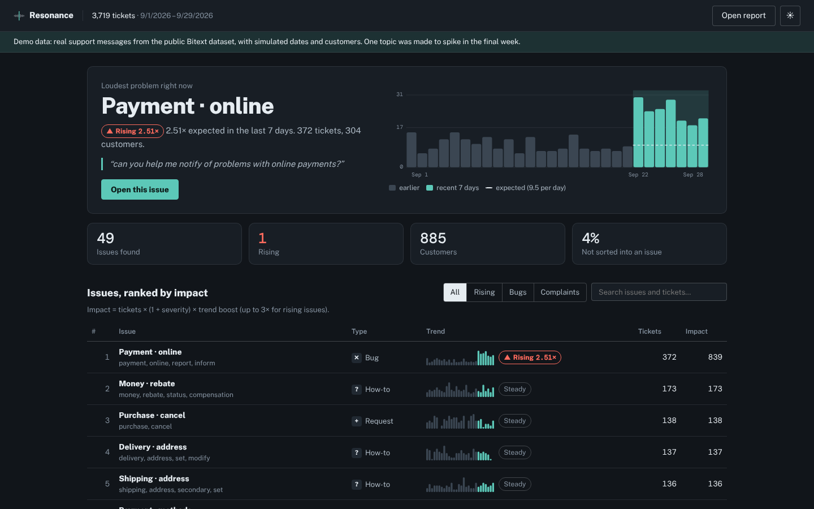
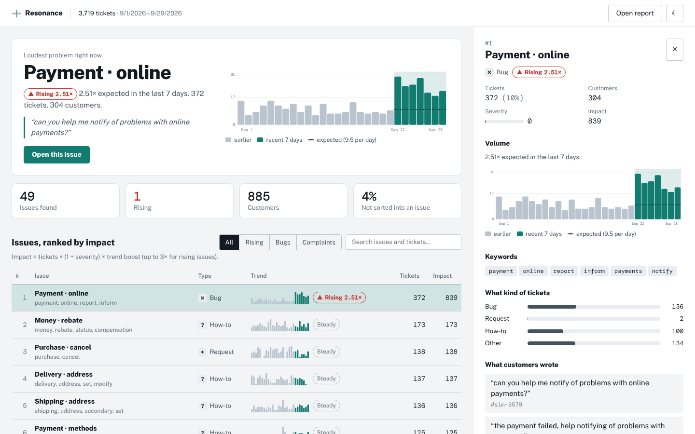

# Resonance

**Find the problems hiding in your support queue.**

Resonance reads thousands of customer-support conversations, groups them into issues, and ranks what to fix first: how many customers are affected, how upset they are, and what's growing fastest. Support tickets are the richest source of product information most companies have, and most of it is thrown away once a ticket is closed.

> College project by [@jay-m007](https://github.com/jay-m007). It rebuilds the idea behind **Answerly** (2013–2016), a support-automation startup that tried to *deflect* tickets with canned answers and ran out of money. Resonance does the opposite: it treats tickets as product evidence. The idea comes from the Loot Drop rebuild plan for Answerly.



```
$ resonance analyze simulated-tickets.csv

Resonance v0.1.0: 3,719 tickets, 2026-09-01 to 2026-09-28, 4.6 s
45 issues found, 1 rising, 169 tickets unsorted (5%)

  #   impact  tickets  trend          type       issue
  1      850      373  ↑ 2.56x        bug        Payment · online
                                  e.g. "can you help me notify of problems with online payments?"
  2      306      306  steady         how-to     Ask · money
                                  e.g. "need to check in what cases can i ask for a reimbursement"
  3      142      142  steady         request    Purchase · cancel
                                  e.g. "cancel purchase [order number]"
```

## Status

| Phase | Scope | Status |
|---|---|---|
| 1 | Engine and CLI: load exports, find issues, name them, type, severity, trends, ranked report | ✅ Done |
| 2 | Evaluation on 26,872 labelled tickets, with baselines and simulated spikes | ✅ Done |
| 3 | Dashboard: loudest problem, ranked issues with trend strips, issue detail | ✅ Done |
| 4 | AI product briefs (optional), README, review | ✅ Done |

## Quick start

```bash
git clone https://github.com/jay-m007/resonance.git
cd resonance
pip install -e ".[dev]"
pytest                                                         # 22 tests

resonance fetch-data                                           # 26,872 labelled support messages (Bitext, CDLA-Sharing 1.0)
resonance simulate data/bitext.csv --spike payment_issue      # a simulated month where payment problems triple in week 4
resonance analyze simulated-tickets.csv -o report.json         # find and rank the issues
```

On your own data: export tickets from your help desk as CSV, JSON or JSON Lines and run `resonance analyze export.csv`. Columns are found by name (`text`/`message`/`body`/`description`…, `created_at`/`date`/`timestamp`…, `customer_id`/`account`…), or set them with `--text-col`, `--time-col`, `--customer-col`.

### Commands

```
resonance analyze  <file>     Find and rank issues; writes a JSON report
    --embed tfidf|st|openai   How to turn text into vectors (default tfidf: no download, no API)
    --k N                     Force N topics (k-means) instead of finding them automatically
    --synthetic               Mark the report as made from simulated data
resonance simulate <file>     A simulated month with one intent spiking (for demos and tests)
resonance eval     <file>     Measure topic quality and trend detection on labelled data
resonance brief    <report>   Add AI-written product briefs for the top issues (needs OPENAI_API_KEY)
resonance fetch-data          Download the Bitext dataset
```

## How it works

```
 export ──► clean & redact ──► vectors ──────────► topics ─────────────► describe ─────────► trends ──────► rank
 CSV/JSON   personal data      TF-IDF (words +     HDBSCAN on a sample,   name, keywords,    Poisson test    impact score
            removed            char n-grams) + LSA nearest-centre assign  type, severity      + FDR control
```

### 1. Load, clean and redact
CSV, JSON and JSON Lines, including what Windows tools write (UTF-8 with BOM, PowerShell's UTF-16, Excel's Windows-1252). Day/month order is decided once for the whole date column, so `04/12` and `04/13` can't be read differently; ambiguous columns need `--dayfirst` or `--monthfirst`. Emails (also `name(at)site.com`), links, card and bank numbers, phone numbers, account references and postcodes are replaced with placeholders before anything is analysed, shown, saved or sent to an AI model. This is pattern-based: names and street addresses written in plain words get through, so treat reports as containing customer data.

### 2. Vectors (embeddings)
Each ticket becomes a vector so that tickets with similar meaning sit close together. The default needs no download: **TF-IDF** over words and two-word phrases, plus character 3–5-grams (so typos like "oorder" and "puchase" still match), reduced to 128 dimensions with **LSA** (truncated SVD), which merges words used in similar contexts. Optional backends: a sentence-transformers model (`pip install -e ".[st]"`, `--embed st`) or an OpenAI-compatible embeddings API (`--embed openai`).

### 3. Topics
1. **Discover** topics with **HDBSCAN** on a sample of up to 8,000 tickets. HDBSCAN finds dense groups and decides the number of topics itself; a topic must hold at least 1/300 of the sample.
2. **Assign** every ticket to the most similar topic centre by cosine similarity, but only if the similarity is at least 0.2. The rest are counted as *unsorted* and shown as such, not forced into a topic. (Fewer than 10 or so tickets go straight to k-means.)

Plain k-means was the first attempt. It needs the number of topics up front, and the standard way to choose it (the silhouette score) kept picking the largest k tried. The 0.2 threshold was chosen on the benchmark below.

### 4. Describe
- **Name and keywords**: words and two-word phrases common in the topic but rare elsewhere: score = p<sub>topic</sub> × log(p<sub>topic</sub> / p<sub>all</sub>), ignoring terms in fewer than 8% of the topic's tickets.
- **Type**: bug, complaint, request, how-to or other, from readable patterns ("not working", "worst", "would like", "how do I"). Bugs and complaints win even when phrased as a question.
- **Severity** (0–1): urgency words ("urgent", "still waiting", "third time"), anger words, "!!!" and SHOUTING.
- **Examples**: the tickets closest to the topic centre, skipping near-duplicates.

### 5. Trends
Tickets are counted per day (per week for more than 8 weeks of data). The last 7 days are compared with everything before. A topic's **expected** recent count is its earlier count times the *median* growth across topics, so a busy week for everyone isn't a spike, and one topic spiking doesn't make all the others look like they're falling (as scaling by the total would). If nothing changed, each of a topic's tickets falls in the recent window with a fixed probability, so its recent count follows a binomial distribution; a **conditional binomial test** gives the chance of a count this high by luck. (A first version used a Poisson test that treated the earlier count as exact; an independent review showed it raised false alarms in about 1 month in 5 with no spike at all.) The **Benjamini–Hochberg** procedure then controls the false discovery rate at 5% across all topics. Rising means: passes that test, at least 1.5× expected, at least 5 recent tickets, and at least 10 earlier ones (so a topic's normal level is known).

### 6. Rank

```
impact = tickets × (1 + severity) × trend factor        trend factor = 1 + min(ratio, 4) / 2 for rising or new issues, else 1
```

Volume counts most; angry and fast-growing issues move up (a rising issue can count up to 3× its size).

## How well it works

### Finding the right topics
On all **26,872** labelled messages of the Bitext dataset (27 true intents), each method's topics are compared with the true intents. Resonance never sees the labels.

| Method | Topics | Sorted | NMI | ARI | NMI* | ARI* |
|---|---:|---:|---:|---:|---:|---:|
| **Resonance** (HDBSCAN + assign) | 32 | 89% | **0.769** | **0.552** | **0.719** | 0.460 |
| k-means, *told* the true number of intents | 27 | 100% | 0.696 | 0.447 | 0.696 | 0.447 |
| k-means, k chosen by silhouette | 60 | 100% | 0.687 | 0.366 | 0.687 | 0.366 |
| Keyword (group by each ticket's top word) | 542 | 100% | 0.629 | 0.144 | 0.628 | 0.143 |

NMI (normalised mutual information) and ARI (adjusted Rand index) measure agreement with the true intents; 1 is perfect, ARI ≈ 0 is random. NMI and ARI are on the tickets each method sorted; **NMI\* and ARI\*** count unsorted tickets as one more topic, the like-for-like comparison.

What this shows: without being told how many topics exist, Resonance does slightly better than k-means that *is* told (NMI\* 0.719 vs 0.696), and on the 89% of tickets it sorts, its topics are clearly cleaner (NMI 0.769). The assignment threshold trades coverage for cleaner topics:

| Assignment threshold | 0.0 | 0.1 | **0.2** | 0.3 | 0.4 |
|---|---:|---:|---:|---:|---:|
| Tickets sorted | 100% | 98% | **89%** | 77% | 68% |
| NMI on sorted tickets | 0.724 | 0.735 | **0.769** | 0.807 | 0.827 |
| NMI\* (like for like) | 0.724 | 0.726 | **0.719** | 0.698 | 0.662 |

A threshold of 0 to 0.1 scores best like for like; 0.2 gives that up by 0.005 for noticeably cleaner topics and an honest "unsorted" bucket for tickets that don't fit anywhere. It was chosen on this same dataset.

### Catching spikes
TREND_RESULTS

## Dashboard

```bash
cd web
npm install
npm run build
npx serve out
```

Open it and click **See a demo month**, or open a `report.json` from `resonance analyze`. Everything stays in your browser.

- **Loudest problem right now**: the highest-impact rising issue, with its volume chart against the expected level.
- **Ranked issues**: type, a volume strip with the recent week highlighted, status (▲ rising, ✦ new, ▼ falling, always with a word, never colour alone), tickets and impact. Filter by rising, bugs or complaints, or search.
- **Issue detail**: severity, customers affected, the volume chart, keywords, the mix of ticket types, what customers actually wrote, and (if the data had labels) how well the issue matches a known label.



## AI product briefs

```bash
export OPENAI_API_KEY=sk-...
resonance brief report.json --top 3
```

For each of the top issues, an OpenAI-compatible model (`--base-url` for others, `--model` to choose) writes a brief: problem, evidence, likely cause (labelled as a hypothesis), suggested fix, and how to verify it. Tickets are written by customers, so they're treated as untrusted: personal details are removed, the tickets are sent inside `<tickets>` tags, and the model is told never to follow instructions inside them. The brief is stripped of links and formatting, shown as plain text, and labelled as AI-written. Briefs are optional; nothing else depends on them.

## Known limitations

- **English only**, and the default vectors are word-based: a topic phrased in completely different words in different tickets may split. The sentence-transformers backend helps with that.
- **Issue types and severity are rule-based**: transparent, but they miss phrasings the rules don't cover (many Bitext tickets come out as "other").
- **The evaluation uses one dataset.** Bitext messages are generated from templates and cleaner than real tickets, and the threshold was tuned on it, so treat the numbers as indicative.
- **Trends need volume.** At around 120 tickets a day spread over 27 topics, a doubling is usually too small to separate from chance; at 400 a day most are caught.
- **The simulated month is synthetic**: real messages, made-up dates and customers. It's marked as such in the CLI and the dashboard.
- It works on exported files; it doesn't connect to Intercom or Zendesk.

## Project structure

```
resonance/
  ingest.py      # load CSV/JSON/JSONL, find columns, parse dates, redact personal data
  embed.py       # TF-IDF + LSA (default), sentence-transformers, OpenAI embeddings
  cluster.py     # HDBSCAN discovery + nearest-centre assignment
  describe.py    # keywords, names, issue types, severity, representative tickets
  trends.py      # Poisson test with median scaling and Benjamini-Hochberg FDR
  analyze.py     # the pipeline and the impact score
  simulate.py    # simulated months with a known spike
  evaluate.py    # topic metrics, baselines, spike-detection test
  brief.py       # AI product briefs
  cli.py         # the `resonance` command
tests/           # pytest
web/             # Next.js static dashboard
```

## Development

```bash
pytest                      # tests
cd web && npm run typecheck && npm run build
```

## Data and license

Code: MIT. The Bitext dataset is not included in the repository; `resonance fetch-data` downloads it. It is © Bitext and licensed under the Community Data License Agreement – Sharing 1.0. The demo report in `web/public/demo` contains messages from it, with simulated dates and customers.
